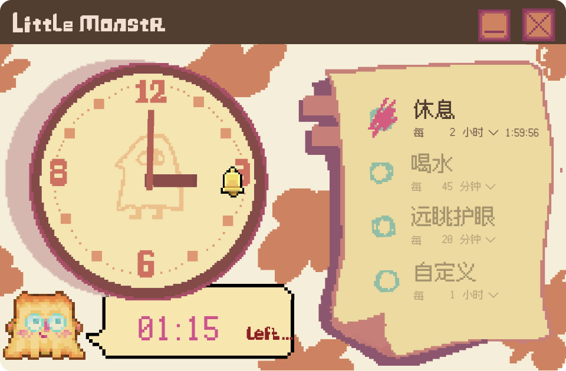
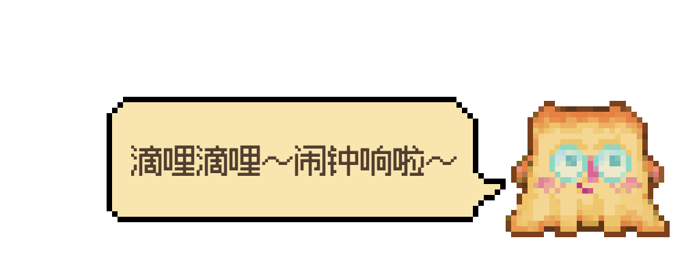

# littleMonstre_deskPet 桌宠小怪兽

一只住在你桌面底部的像素小怪兽。它会提醒你休息、喝水、看看远处，也能当闹钟用。

## 下载

到 [Releases 页面](https://github.com/chenyishu2024-stack/little-monstre-DeskPet/releases/latest) 下载最新版：

| 系统 | 下载文件 |
|---|---|
| Windows 10 / 11（64 位） | `littleMonstre_deskPet-Setup-x.x.x.exe` |
| Mac（M1/M2/M3 等 Apple 芯片） | `littleMonstre_deskPet-x.x.x-arm64.dmg` |
| Mac（Intel 芯片） | `littleMonstre_deskPet-x.x.x.dmg` |

> 不确定 Mac 是哪种芯片：点左上角苹果图标 → 关于本机，看"芯片"一栏。

### 第一次打开时被系统拦住？

软件暂时没有购买开发者签名，所以第一次打开会有安全提示，这是正常的：

- **Windows**：弹出"Windows 已保护你的电脑" → 点 **更多信息** → **仍要运行**。
- **Mac**：把 littleMonstre_deskPet 拖进"应用程序"后，**右键**它 → **打开** → 再点 **打开**。之后就能正常双击打开了。

## 怎么玩

**主界面**
- 右边便签上有 4 个提醒（休息 / 喝水 / 远眺护眼 / 自定义），点圆圈开关，名字和间隔都能直接改。默认只开"每 2 小时休息一下"。
- 左边的时钟跟着系统时间走。**拖动时针或分针**就能设闹钟，气泡里显示还剩多久，表盘上的小铃铛标出闹钟位置；双击倒计时数字可以取消。
- 点右上角"–"，主界面收起，小怪兽跑到桌面底部陪你。

**桌面上的小怪兽**
- 单击：摸摸头
- 双击：打开主界面
- 按住拖动：把它拎起来，它会跟着晃；松手会掉回桌面底部
- 平时它会自己溜达、发呆、偶尔扭扭屁股；你很久不碰电脑，它会睡着
- 时间到了，它会跳出来"说话"提醒你，点它一下表示知道了

## 版权声明

© 2026 IChou. 保留所有权利。

本软件（包括小怪兽形象、动画、界面设计及其他美术素材）仅供个人免费下载使用。**未经作者书面许可，禁止提取、转载、修改、二次分发或用于任何商业用途。**

本软件使用的像素字体 [Fusion Pixel Font](https://github.com/TakWolf/fusion-pixel-font) 遵循 SIL Open Font License 1.1。
